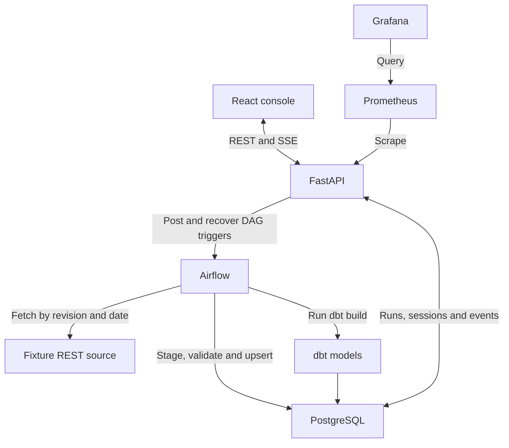

# PipelineOps

PipelineOps is a local console for operating a synthetic e-commerce order pipeline. An operator can launch an Airflow run, inspect validation errors, select a corrected source fixture, and retry. Viewers can read the history and audit trail in their workspace.

## Quick start on Windows

Start Docker Desktop in Linux-container mode. Open PowerShell in the directory containing the ZIP.

```powershell
Expand-Archive -LiteralPath .\PipelineOps.zip -DestinationPath .
Set-Location -LiteralPath .\PipelineOps
Set-ExecutionPolicy -Scope Process -ExecutionPolicy Bypass
.\scripts\Start.ps1
.\scripts\Smoke.ps1
.\scripts\Demo.ps1
```

The start script prints `Stack started. Dashboard http://localhost:5173`. The other scripts print `SMOKE PASSED` and `DEMO PASSED` on success. The first build downloads public container images and dependencies. Allow several minutes for the build and demo. Docker Desktop must have room for PostgreSQL, Airflow, Grafana, Prometheus and the frontend images. Actual Windows resource usage was unmeasured.

Open [PipelineOps](http://localhost:5173). All application demo accounts use `pipeline-demo`.

| Username | Workspace | Role |
| --- | --- | --- |
| `operator` | North | Start runs, retry failed runs, read history and audit |
| `viewer` | North | Read runs, errors, events, and audit |
| `south-operator` | South | Operate only the South workspace |

| Endpoint | Default | Port override in PowerShell before startup |
| --- | --- | --- |
| Dashboard | [localhost:5173](http://localhost:5173) | `$env:WEB_PORT = '15173'` |
| API and OpenAPI | [localhost:8000/docs](http://localhost:8000/docs) | `$env:API_PORT = '18000'` |
| Airflow | [localhost:8080](http://localhost:8080) | `$env:AIRFLOW_PORT = '18080'` |
| Prometheus | [localhost:9090/targets](http://localhost:9090/targets) | `$env:PROMETHEUS_PORT = '19090'` |
| Grafana | [localhost:3000/d/pipelineops/pipelineops](http://localhost:3000/d/pipelineops/pipelineops) | `$env:GRAFANA_PORT = '13000'` |

The frontend proxies API calls through its own origin. Port overrides change host bindings only. For direct API requests from another frontend origin, extend the explicit `CORS_ORIGINS` allowlist in the API service. PostgreSQL and the synthetic source are accessible within Compose. Optional local Airflow UI login is `pipeline` / `local-airflow-demo`. The Grafana dashboard has anonymous localhost viewing. Monitoring and Airflow are local infrastructure consoles with aggregate or cross-workspace operational visibility. The application authorization applies to the PipelineOps API and dashboard. Credentials and endpoints are for local synthetic data.

```powershell
docker compose ps
docker compose stop                 # Stop services and retain volumes.
.\scripts\Start.ps1                  # Start again with the same volumes.
docker compose down                 # Remove containers and retain volumes.
.\scripts\Reset.ps1 -ConfirmReset    # Delete all local stack data.
```

Reset removes the project containers, network, PostgreSQL volume (orders, runs, sessions, demo members, test and Airflow databases), shared Airflow task logs, Prometheus history, and Grafana state. The project files and cached images remain available. Run Start again to get a freshly seeded stack. On Bash, run `./scripts/start.sh` and `./scripts/smoke.sh` from the project folder, or invoke either script by its full path.

## Browser walkthrough

1. Sign in as `operator`. Wait for **Live** beside the page title.
2. Keep **Backfill** and the default source window, January 1 through January 3, 2025. Select **Clean** and click **Start run**. Wait for **succeeded**. The task timeline shows ingestion, validation, loading, and dbt.
3. Return to **All runs**, choose **Changed (invalid)**, and start another run. The detail view refreshes from authenticated events. Expect **failed** and 48 affected orders starting with `D-0001`. Copy the correlation ID.
4. On that failed run, select **Use corrected demo fixture** and click **Retry run**. The new execution uses the original window and the corrected CSV for the same order IDs. Open **Original run** to revisit the preserved issues, and **Audit** to see the `retry_corrected` entry with actor, workspace and timestamp.
5. Launch **Corrected** again with the same backfill window. The scripted demo checks that a replay leaves one row per workspace and order ID and that analytics totals match the destination table.
6. Sign out and sign in as `viewer` to inspect the failed run. The viewer has no retry action. The demo also makes the direct retry request and expects HTTP 403. Sign in as `south-operator` to see only South. The demo probes North’s live stream and run and retry endpoints using the South account. Requests to the North workspace return 403 and a North run ID queried inside South returns 404.
7. Open Grafana. After the next Prometheus scrape, the **Failed runs** and **Successful retries** panels should both show nonzero counts. The **Temporary 503, then clean** source option reproduces two backoff events before a successful read.

Find a correlated incident in PowerShell.

```powershell
$id = 'paste-the-full-correlation-id-here'
docker compose logs --no-color api source | Select-String -SimpleMatch $id
docker compose exec -T airflow-scheduler grep -R -F -- $id /opt/airflow/logs/dag_id=orders_pipeline
```

## Data and execution



- Every run stores its workspace, correlation ID, actor, source revision, and half-open source window `[start, end)`. The mock source filters by delivery date (`source_date`), so a malformed business date could still reach validation. The pipeline validates order ID, business date, positive decimal amount, and within-batch uniqueness before loading. One validation error rejects the entire batch. Staged payloads and the per-order violations remain available in PostgreSQL.
- Incremental runs begin at the workspace’s previous successful end date or `PIPELINE_FIRST_SOURCE_DATE` (default `2025-01-01`). They advance by `PIPELINE_WINDOW_DAYS` (default 1). A successful empty interval also advances the checkpoint. Backfills use explicit windows up to 366 days and leave the checkpoint in place. Defaults fit the bundled 2025 fixtures. Set the variables in PowerShell with `$env:PIPELINE_WINDOW_DAYS = '2'` before starting, or use a project-local `.env` file. Recreate the services after changing settings.
- Airflow runs the daily schedule `0 4 * * *` UTC with catchup disabled. Configure `PIPELINE_SCHEDULE` and `PIPELINE_SCHEDULE_WORKSPACE` (default `north`). The scheduled DAG ingests the clean revision from the next source window. API launches use a durable queued run and a deterministic Airflow DAG run ID so the dispatcher can safely retry a lost dispatch response. Airflow runs one DAG execution at a time and the tasks within it are sequential. The source client retries transient transport errors and selected HTTP responses with delays of 1, 2, and 4 seconds. Data validation failures surface immediately.
- Postgres locks the original run row during retry creation. A unique parent key and one transaction ensure concurrent submissions return the same child and record one retry audit entry. A child that fails can itself be retried. An operator must explicitly select the corrected fixture. Loading upserts on `(workspace, order_id)`. Loading commits before dbt runs, so a dbt failure can leave valid orders present. The run remains failed and a retry can safely load the same valid rows again.
- dbt builds `analytics.daily_order_totals` and `analytics.data_quality_trends`. Totals reflect the latest successful materialization. The quality view tracks attempted runs and recorded failures directly once created. Generic dbt tests check keys, required fields, and workspace relationships.
- The statistics tile compares independent fixture cohorts of 240 orders each, with 12 baseline and 48 changed orders rejected. It measures row-level synthetic validation rejection, counting each rejected row once regardless of violations. The operational **Clean** fixture is a separate, fully valid demo input. The two-sided pooled z-test and unpooled 95% Wald interval require at least 10 successes and failures per cohort and adequate expected counts. The seeded difference is 15 percentage points. Values describe the synthetic cohorts.
- Bearer tokens are stored in memory on the frontend and as expiring hashes in the database. REST and SSE use the same authorization header. SSE rechecks membership and session validity, orders events by cursor, and reconnects with the previous event ID. The UI refreshes the active view on reconnect. Correlation IDs appear in events and JSON logs. Prometheus uses only bounded outcome and retry labels plus fixed duration buckets.

## Tests and the indexing example

```powershell
@'
SELECT 'CREATE DATABASE pipeline_test OWNER pipeline'
WHERE NOT EXISTS (SELECT FROM pg_database WHERE datname='pipeline_test') \gexec
'@ | docker compose exec -T db psql -v ON_ERROR_STOP=1 -U pipeline -d postgres
docker compose exec -T -e TEST_DATABASE_URL=postgresql+psycopg://pipeline:pipeline-local@db:5432/pipeline_test api python -m pytest -q
docker compose --profile test run --build --rm browser-tests
Get-Content -LiteralPath .\scripts\index-example.sql -Raw | docker compose exec -T db psql -v ON_ERROR_STOP=1 -U pipeline -d pipeline
```

The PostgreSQL integration tests recreate the public schema in the dedicated `pipeline_test` database. The browser test uses the running stack and creates its own runs. The index benchmark inserts 200,000 rows across 200 workspaces in a temporary table, analyzes it, and executes the tenant history query before and after the composite index. The transaction rolls back at the end. See [verification.md](verification.md) for observed plans and timings.

## Optional Terraform

The Terraform configuration provisions a private, encrypted RDS PostgreSQL instance with a Secrets Manager-managed master password, and a versioned, encrypted S3 bucket with public access blocked. Supply an existing VPC, two private subnets across availability zones, the application security group, and a bucket name when adapting it. The local demo uses the fixture service and local Postgres. Provider initialization and validation require network access but create no cloud resources.

```powershell
Set-Location -LiteralPath .\terraform
terraform fmt -check
terraform init -backend=false
terraform validate
```

## Interview walkthrough

Start with the **Changed** batch. Show how the date filter selects the window, how Pydantic records every invalid row, and why loading waits for validation. Follow one error by correlation ID into an Airflow task log. Then submit a corrected retry, show its parent and audit record, and explain how the row lock and unique parent constraint make two requests converge on the same retry. Finish with the destination key, the dbt totals, and the Grafana recovery panel.

| Skill | Where to show it |
| --- | --- |
| Airflow orchestration | `dags/orders_pipeline.py` defines the schedule and task dependencies. `ops/api.py` posts deterministic manual run IDs. |
| Incremental ETL and backfills | `ops/runs.py` chooses the window and `ops/pipeline.py` advances the checkpoint. `ops/demo.py` asserts it after transient recovery. |
| SQL upserts, constraints and indexing | `migrations/001_schema.sql`, `migrations/002_run_history.sql`, `ops/pipeline.py`, and `scripts/index-example.sql`. |
| dbt | `dbt/models/` contains the models and schema tests. `ops/demo.py` checks seeded outputs. |
| FastAPI and Pydantic | `ops/api.py` defines typed requests and permissions. `ops/core.py` validates the batch. |
| SSE and React/TypeScript | `ops/api.py` and `web/src/client.ts` handle the stream and reconnect. `web/tests/recovery.spec.ts` covers the live workflow. |
| Tenant isolation and safe retry | `ops/api.py` enforces membership, role and run ownership. `tests/test_postgres.py` tests two workspaces and concurrent retry. |
| Audit and correlation | `ops/runs.py` writes audit entries and correlated event logs. `ops/source.py` logs the same correlation ID. |
| Statistics and pytest | `ops/core.py` implements the comparison, bounds backoff and defines validation. `tests/` checks those cases with PostgreSQL integration coverage. |
| Prometheus and Grafana | `ops/api.py`, `monitoring/`, and the smoke test. |
| Terraform | `terraform/` contains optional S3, RDS and security group configuration and a provider lock. |
